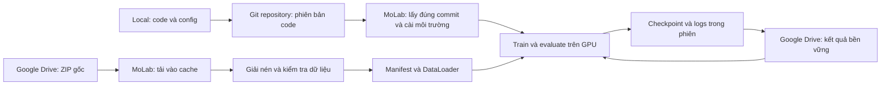

# CRISP-DA: từ code local đến sử dụng dataset Google Drive trên MoLab

Ngày lập: **17/10/2026**. Đây là hướng dẫn triển khai, chưa phải báo cáo một lần train đã hoàn thành.

**Cập nhật mã nguồn B0:** pipeline local và CLI đã được tạo sau khi lập hướng dẫn này. Dùng [README_B0.md](README_B0.md) cho các lệnh đã triển khai, và [B0_VALIDATION.md](B0_VALIDATION.md) cho trạng thái kiểm chứng. Các ví dụ trong hướng dẫn này vẫn mô tả luồng tổng thể; quyền Drive và quota MoLab cần được thiết lập/kiểm tra trong phiên thực tế.

Tài liệu đi cùng [CRISP_DA_IMPLEMENTATION_PLAN.md](CRISP_DA_IMPLEMENTATION_PLAN.md). Các quyết định về thuật toán, nhãn và đánh giá tiếp tục theo kế hoạch đó, đặc biệt mục 2 và 15. Tài liệu này cụ thể hóa đường đi của code, dữ liệu và kết quả với **Google Drive** làm kho dữ liệu.

## 1. Đích cần đạt và trạng thái hiện tại

Đích đầu tiên: code viết ở local được chạy trên GPU MoLab, đọc được ảnh và mask đã giải nén từ ZIP trên Drive, thực hiện forward/backward B0, đánh giá thử, lưu checkpoint lên Drive và khôi phục được. Sau đó mới chạy B0 đầy đủ, B1 và các thành phần CRISP-DA.

| Hạng mục | Bằng chứng hiện có | Điều chưa xác nhận |
|---|---|---|
| Workspace local | `F:\CRISP_DA`, đã có mã nguồn B0 và tài liệu | Chưa chạy benchmark với dataset GTA/Cityscapes thật |
| Notebook | [MoLab của project](https://molab.marimo.io/notebooks/nb_Aa5wx28s276th2TdLsnLKr) | Chưa kiểm tra trực tiếp các cell; thông tin runtime bên dưới do người dùng chạy và cung cấp |
| GPU | RTX PRO 6000 Blackwell Server Edition; 94,97 GiB VRAM, 94,43 GiB trống tại thời điểm đo | Chưa chạy model SegFormer thực tế |
| PyTorch/CUDA | `2.11.0+cu130`, CUDA của PyTorch `13.0`, driver `595.71.05`; CUDA available và phép tính thử PASS | Chưa kiểm tra toàn bộ dependency, pretrained weights và backward của B0 |
| RAM | Giới hạn container 160 GiB, khoảng 159,88 GiB khả dụng khi đo | Mức sử dụng khi đọc dữ liệu và train |
| Đĩa | `/marimo`, `/tmp`, `/` cùng mount `/`, loại `overlay`, báo 8 EiB | Quota ghi thực tế và tốc độ I/O |
| Dataset Drive | Có 22 ZIP, khoảng 68,12 GiB nén | Nội dung ZIP, số mẫu, cặp ảnh–nhãn và encoding chưa kiểm tra |

**Không dùng con số 8 EiB để quyết định tải toàn bộ dataset.** Đổi từ `/marimo` sang `/tmp` không tạo thêm filesystem riêng. Không ghi file khổng lồ chỉ để thử lấp đầy ổ.

Con số khoảng 81 GB trong kế hoạch cũ là ước lượng trước đó. Với các file Drive đã liệt kê trong phiên làm việc này, dùng **68,12 GiB cho tổng ZIP hiện có**; kích thước giải nén phải đo riêng. Không diễn giải hai con số là cùng một phép đo.

## 2. Phân công giữa local, Git, MoLab và Drive



- Local chứa code Python, cấu hình, tài liệu và kiểm thử; có thể dùng một tập dữ liệu nhỏ để debug.
- Git lưu phiên bản code. Dataset, checkpoint lớn, token và `.env` nằm ngoài Git.
- MoLab chạy cùng code trên GPU. Notebook điều phối các module trong repository.
- Drive giữ ZIP gốc và kết quả cần tồn tại sau khi phiên MoLab kết thúc.

Sửa file trên máy local không tự cập nhật bản code đang chạy trong MoLab. Mỗi lần chạy cần lấy phiên bản đã chọn và ghi lại commit.

## 3. Bước 1 — dựng bộ mã nguồn tại local

Cấu trúc bên dưới là thiết kế tổng quát. Phần B0 đã được tạo; tên file và lệnh hiện có được ghi cụ thể trong README_B0.md. Các module cho B1/CRISP-DA đầy đủ vẫn là phần triển khai sau:

```text
CRISP_DA/
├── pyproject.toml
├── .gitignore
├── configs/
│   ├── b0_source_only.yaml
│   └── data_drive.yaml
├── notebooks/
│   └── molab_train.py
├── src/crisp_da/
│   ├── data/       # GTA, Cityscapes, mapping, transforms, manifest
│   ├── models/     # SegFormer và các module theo từng mốc
│   ├── engine/     # train, evaluate, checkpoint
│   └── utils/     # config, seed và thông tin môi trường
├── scripts/
│   ├── prepare_data.py
│   ├── inspect_data.py
│   ├── train.py
│   └── evaluate.py
└── tests/
```

Thứ tự thực hiện:

1. Tạo cấu hình và cơ chế nhận đường dẫn từ config hoặc biến môi trường.
2. Viết phần chuẩn bị dữ liệu độc lập với training: tải, kiểm tra, giải nén, manifest.
3. Viết Dataset và transforms; kiểm tra nhãn, ghép cặp và overlay.
4. Viết model B0, loss, optimizer, evaluate và checkpoint.
5. Viết notebook launcher gọi các chức năng đó.

Tên tham số CLI của các script cần được chốt lúc triển khai. Không coi tên script trong tài liệu là lệnh chạy được trước khi chúng được viết.

Các biến đường dẫn dùng thống nhất:

| Biến | Vai trò | Ví dụ trên MoLab, có thể đổi |
|---|---|---|
| `PROJECT_ROOT` | Mã nguồn repository | `/marimo/crisp-da` |
| `CACHE_DIR` | ZIP tải về, file tải dở | `/marimo/crisp-work/cache` |
| `DATA_ROOT` | Ảnh, mask đã giải nén | `/marimo/crisp-work/data` |
| `RUN_DIR` | Checkpoint, config và logs của một run | `/marimo/crisp-work/runs/b0-smoke-001` |

Đây là cách tổ chức thư mục, không phải bốn ổ đĩa riêng. Dataset dùng đường dẫn tương đối trong manifest; lúc đọc ghép với `DATA_ROOT` để chạy được trên cả Windows và Linux.

## 4. Bước 2 — đưa code từ local lên MoLab

### Luồng chính: dùng Git repository

1. Khởi tạo Git ở local nếu chưa có, thêm `.gitignore`, kiểm tra danh sách file trước khi commit.
2. Tạo hoặc chọn remote repository và push code. URL repository hiện chưa được cung cấp; không tự giả định repository đã tồn tại.
3. Trong phiên MoLab, clone repository lần đầu. Nếu private, thiết lập quyền đọc qua cơ chế xác thực phù hợp; không nhúng token vào URL hoặc notebook.
4. Chọn một commit cụ thể trước mỗi run. Ghi commit vào config kết quả và checkpoint.
5. Khi cập nhật: dừng run đang hoạt động, lấy commit mới, kiểm tra dependency rồi khởi động lại tiến trình training. Không thay code giữa một lần train đang chạy.

Nếu chưa dùng remote Git, có thể đóng gói **chỉ mã nguồn** thành ZIP rồi upload qua Files của MoLab; giải nén và ghi checksum gói code. Đây là đường thay thế để chuyển code, không phải cách upload dataset 68 GiB.

MoLab có hỗ trợ mirror notebook từ GitHub. Với project nhiều module, vẫn phải bảo đảm toàn bộ package và config có mặt trong runtime; không suy rằng một notebook được mirror sẽ tự đem theo mọi file của repository. [Tài liệu MoLab](https://docs.marimo.io/guides/molab/).

### Cài môi trường trong đúng Python của notebook

Sau khi repository đã có `pyproject.toml` hợp lệ, có thể cài package của project bằng cell sau. Đường dẫn phải trỏ đúng repository vừa lấy về:

```python
def _install_project():
    import subprocess
    import sys
    from pathlib import Path

    project = Path("/marimo/crisp-da")
    if not (project / "pyproject.toml").is_file():
        raise FileNotFoundError("Chưa có repository/package hợp lệ tại đường dẫn này")
    subprocess.run(
        [sys.executable, "-m", "pip", "install", "-e", str(project)],
        check=True,
    )

_install_project()
```

Chốt dependency phù hợp với PyTorch/CUDA đã chạy thành công. Tránh tự động nâng/hạ PyTorch chỉ vì cài thêm thư viện; đọc kết quả cài đặt và kiểm tra lại GPU sau khi môi trường thay đổi. Ghi Python, PyTorch, CUDA, thư viện model và pretrained checkpoint vào run metadata. Nếu kernel đã import phiên bản package cũ, khởi động lại kernel khi cần.

## 5. Bước 3 — kết nối Google Drive từ chính MoLab

Kết nối Google Drive trong cuộc chat không cấp quyền cho Python của notebook. Người dùng cần xác thực riêng trong MoLab bằng tài khoản có quyền truy cập folder.

Theo hướng dẫn chính thức: mở **Files → Add remote storage → Google Drive**, làm theo giao diện và chạy đoạn kết nối được sinh ra. Hoàn thành OAuth, sau đó tìm thư mục dataset trong Remote Storage. Giao diện có thể sinh snippet đọc hoặc tải cho file đã chọn. Ưu tiên snippet này để lấy đúng đường dẫn mà connector nhận. [Remote storage in molab](https://marimo.io/blog/drive-storage).

Ví dụ kết nối trong tài liệu chính thức:

```python
from gdrive_fsspec import GoogleDriveFileSystem

fs = GoogleDriveFileSystem(
    use_listings_cache=False,
    skip_instance_cache=True,
)
```

Cell này cần package và thiết lập xác thực của MoLab; bản thân việc copy hai dòng không bảo đảm OAuth đã được cấu hình. Nếu giao diện sinh code khác, dùng code thực tế của giao diện.

Không truyền nguyên URL chia sẻ vào một hàm nhận filesystem path nếu chưa kiểm tra API. **Drive file ID, URL chia sẻ và path của `gdrive-fsspec` là ba dạng tham chiếu khác nhau.** Lưu ID để xác định file, rồi dùng đường dẫn do explorer/API trả về cho thao tác tải. Không dùng `google.colab.drive.mount()` trong luồng MoLab này.

Kết nối đạt yêu cầu khi:

- Liệt kê được folder dataset và metadata của một ZIP.
- Tải được một file được chọn vào cache của phiên.
- Có thư mục kết quả riêng trên Drive và kiểm tra được quyền ghi nếu muốn đồng bộ checkpoint.

Thông tin xác thực đặt trong cơ chế Secrets của MoLab; không in token ra output hoặc commit vào Git.

## 6. Danh mục dataset đã quan sát

[Folder gốc](https://drive.google.com/drive/folders/152X4MmA3TBnK9QvxozzYseMOQ2PrOfB3)

```text
dataset trên Drive/
├── gta/
│   ├── images/  01_images.zip ... 10_images.zip
│   └── labels/  01_labels.zip ... 10_labels.zip
└── cityscapes/
    ├── leftImg8bit_trainvaltest.zip
    └── gtFine_trainvaltest.zip
```

| Nhóm | Folder ID | Dung lượng nén xấp xỉ |
|---|---|---:|
| GTA images | `1is_XRnMtBaO7M8GQfqZpYVZbD6HOG1Jr` | 56,40 GiB |
| GTA labels | `1jBsnTcHMLdlU9XxPleuKTbjndEZLumov` | 0,69 GiB |
| Cityscapes | `1L0zibkheRZZmUNMONbUEEGsTuHdODzKD` | 11,03 GiB |

File tham chiếu cho lần thử đầu và Cityscapes:

| File | Drive file ID | Số byte theo metadata đã đọc |
|---|---|---:|
| `01_images.zip` | `1jH9PZDEnEu7fj2elIHcOVWwKWT3ZbWHs` | 6138548997 |
| `01_labels.zip` | `1DeUT8mMJSjT6Mh-Hx3PHfuob3vAUPaFX` | 72621271 |
| `leftImg8bit_trainvaltest.zip` | `1Jnd3b3_9X4L29IO1BjFIqIeMjMvAjXX6` | 11592327197 |
| `gtFine_trainvaltest.zip` | `14dDknsv5WhtSVe5kzemhzFxm0UM3FoNL` | 252567705 |

Đây là snapshot ngày 17/10/2026. Trước tải cần đọc lại metadata để phát hiện file bị thay thế hoặc cập nhật. Đủ tên ZIP chưa chứng minh đủ mẫu bên trong.

## 7. Bước 4 — chọn phạm vi dữ liệu và lập dự toán ổ đĩa

### Lần thử pipeline đầu tiên

Tải cặp `01_images.zip` và `01_labels.zip` vào cache. Sau khi kiểm tra danh sách thành viên ZIP, chọn một tập nhỏ các sample ID có cả ảnh và nhãn để giải nén và kiểm tra. Hai ZIP cùng số thứ tự chỉ là đầu mối; cần đối chiếu sample ID thực tế.

Để thử evaluate trên Cityscapes, cần thêm dữ liệu val từ hai ZIP Cityscapes. Nếu dùng cách tải ZIP thông thường, vẫn phải tải nguyên ZIP dù chỉ giải nén phần val. Không hứa giảm băng thông chỉ bằng việc chọn ít file lúc giải nén. Đọc từng phần ZIP từ xa là một tối ưu riêng, chỉ dùng khi đã kiểm chứng khả năng đọc theo khoảng byte và độ ổn định của backend.

### Lần train đầy đủ

Dung lượng đỉnh cần dự toán:

```text
ảnh và mask đã giải nén cần giữ
+ ZIP đang tải hoặc chờ giải nén
+ pretrained weights và cache thư viện
+ checkpoint, logs và temporal memory lưu trên đĩa nếu có
+ phần dự phòng
```

Có thể tải và giải nén từng ZIP, rồi xóa bản ZIP tạm đã xác minh để giảm dung lượng đỉnh. Tổng dữ liệu giải nén vẫn phải vừa ổ có thể sử dụng.

Vì quota hiện chưa biết, lần thử nhỏ chỉ xác nhận khả năng I/O ở quy mô đó. Trước khi tải toàn bộ, cần quota đủ từ nền tảng hoặc phương án cache có giới hạn dung lượng được xác định rõ. Nếu phải dùng shard, thiết kế sampler để bao phủ dataset và ghi chính sách vào thí nghiệm; không âm thầm chỉ train trên những file tải được.

Không coi 160 GiB RAM là dung lượng ổ đĩa. DataLoader chỉ giữ một lượng batch có kiểm soát trong RAM.

## 8. Bước 5 — tải và giải nén có thể chạy lại

Module `prepare_data` cần thực hiện các bước sau; đây là yêu cầu cho code sẽ viết:

1. Đọc catalog: file ID, tên, size, phiên bản/thời gian sửa và checksum nếu lấy được.
2. Tải vào tên tạm `.part` bằng cơ chế tải đã xác thực. Có retry hữu hạn; resume download chỉ bật khi backend thực sự hỗ trợ.
3. So sánh số byte, checksum tham chiếu nếu có. Hash tự tính chỉ giúp nhận diện bản đã tải; không chứng minh giống bản gốc khi chưa có hash tham chiếu.
4. Kiểm tra ZIP mở được, danh sách thành viên và kích thước giải nén. Phát hiện đường dẫn tuyệt đối, `..`, symlink không mong muốn và tên trùng trước khi giải nén.
5. Giải nén vào thư mục staging. Kiểm tra CRC khi đọc dữ liệu; nếu kiểm tra toàn bộ archive thì cần đọc toàn bộ các member, không chỉ mở danh sách.
6. Chuẩn hóa thư mục theo nội dung thật. Không để sinh đường dẫn lồng `images/images/`; không ghi đè âm thầm khi các ZIP có tên thành viên trùng.
7. Kiểm tra kết quả, ghi marker hoàn tất kèm phiên bản catalog; sau đó mới chuyển staging thành dữ liệu dùng được.
8. Chỉ xóa bản ZIP tạm khi phần dữ liệu cần dùng đã được xác minh. Giữ nguyên ZIP gốc trên Drive.

Lần chạy lại chỉ bỏ qua phần có marker và metadata phù hợp. Thư mục tồn tại hoặc ZIP cùng tên chưa đủ để kết luận bước trước thành công. Lỗi tải, thiếu mẫu hoặc giải nén dở phải hiện rõ và chặn run đầy đủ.

## 9. Bước 6 — tổ chức dữ liệu để Dataset đọc được

Cấu trúc mục tiêu dưới đây là quy ước của project, chưa phải cấu trúc bên trong ZIP đã được kiểm tra:

```text
DATA_ROOT/
├── gta/
│   ├── images/
│   └── labels/
├── cityscapes/
│   ├── leftImg8bit/
│   │   ├── train/<city>/
│   │   └── val/<city>/
│   └── gtFine/
│       └── val/<city>/
└── manifests/
    ├── source_train.jsonl
    ├── source_dev.jsonl
    ├── target_train.jsonl
    └── target_val.jsonl
```

| Giai đoạn | Dữ liệu cần nạp |
|---|---|
| B0 | GTA source train/dev; Cityscapes val để đánh giá |
| B1 và adaptation | Thêm Cityscapes `leftImg8bit/train`, chỉ ảnh |
| Test chính thức nếu làm sau này | Ảnh test cho inference và quy trình submit riêng |

Chỉ giải nén những split cần dùng. Không cung cấp `gtFine/train` cho target training loader; nhãn target train không được dùng cho pseudo-label, calibration hoặc cập nhật bank. Test annotations công khai không dùng để tính mIoU chính của project.

Mỗi manifest ghi `sample_id`, `image_path`, `label_path` nếu có, split, kích thước ảnh. Đường dẫn tương đối so với `DATA_ROOT`. Target train manifest không chứa đường dẫn nhãn GT. Sample ID ổn định qua phiên để phục vụ temporal memory; không lấy số thứ tự batch làm ID.

Tách GTA source train/dev cố định theo ảnh hoặc nhóm cảnh khi có metadata. Lưu seed, danh sách ID và hash; dùng cùng split cho các thí nghiệm.

## 10. Bước 7 — kiểm tra nội dung trước khi train

1. Ảnh và nhãn GTA ghép theo sample ID, không ghép chỉ bằng vị trí hai danh sách đã sort. Cityscapes ghép theo tiền tố sample và hậu tố loại annotation.
2. Phát hiện ảnh thiếu nhãn, nhãn thừa, ID trùng, file hỏng, kích thước ảnh–mask không khớp; xuất báo cáo số lượng.
3. Xác minh encoding từ annotation thực tế: `raw_ids` hay `train_ids`. Cấu hình phải nêu rõ để tránh remap hai lần.
4. Sau mapping, nhãn thuộc `{0, ..., 18, 255}`. Kiểm tra cả tên class và overlay; màu PNG hiển thị không đủ xác định encoding.
5. Với Cityscapes val, tạo train IDs từ label IDs theo mapping đã khóa nếu cần, giữ file gốc. Bộ công cụ chính thức cũng cung cấp cách tạo ảnh train IDs từ polygons. [Cityscapes preparation](https://github.com/mcordts/cityscapesScripts/blob/master/cityscapesscripts/preparation/createTrainIdLabelImgs.py).
6. Resize/crop/flip ảnh và mask đồng bộ; mask dùng nearest-neighbor. In histogram class, hiển thị RGB–mask–overlay.
7. Dataset trả tensor và metadata theo mục 15.2 của kế hoạch; DataLoader tạo batch. Ban đầu có thể dùng ít worker để debug rồi tăng dựa trên tốc độ và RAM thực tế.

Kết quả phải phân biệt rõ **subset chạy thử** và **manifest đầy đủ**. Không gọi mIoU trên vài ảnh thử là kết quả benchmark toàn bộ Cityscapes val.

## 11. Bước 8 — bố trí notebook MoLab và gọi code

Notebook gồm các cell theo luồng:

| Cell | Việc thực hiện | Điều kiện hoàn thành |
|---|---|---|
| 1 | Báo cáo môi trường | GPU/CUDA hoạt động, RAM và storage được ghi nhận |
| 2 | Lấy repository, cài package | Import được `crisp_da`, biết commit và dependency |
| 3 | Cấu hình paths và run ID | Đường dẫn được tạo/kiểm tra; không dùng đường dẫn Windows |
| 4 | Xác thực Drive | Đọc được file dataset và xác định nơi lưu kết quả |
| 5 | Prepare data | ZIP cần thiết đã kiểm tra, dữ liệu giải nén có marker |
| 6 | Inspect data | Manifest và mapping hợp lệ, overlay đúng |
| 7 | Chạy thử B0 | Forward/backward, loss, evaluate và checkpoint hoạt động |
| 8 | Đồng bộ kết quả | Checkpoint trên Drive được kiểm tra đọc lại |
| 9 | Resume hoặc run chính | Đọc đúng checkpoint/config và tiếp tục đúng step |

Các thao tác tải nhiều GB, train và upload cần được kích hoạt chủ động, tránh tự chạy lại vì sửa một cell phụ thuộc. Marimo quản lý phụ thuộc giữa các cell; dùng biến tạm có tiền tố `_` hoặc đóng gói trong hàm để tránh định nghĩa tên trùng. [Quy tắc biến của marimo](https://docs.marimo.io/guides/understanding_errors/multiple_definitions/).

Sau khi `scripts/train.py` đã được triển khai theo CLI tương ứng, mẫu launcher có thể là:

```python
def _launch_b0():
    import os
    import subprocess
    import sys
    from pathlib import Path

    project = Path("/marimo/crisp-da")
    env = os.environ.copy()
    env.update({
        "DATA_ROOT": "/marimo/crisp-work/data",
        "CACHE_DIR": "/marimo/crisp-work/cache",
        "RUN_DIR": "/marimo/crisp-work/runs/b0-smoke-001",
    })
    subprocess.run(
        [sys.executable, "scripts/train.py",
         "--config", "configs/b0_source_only.yaml"],
        cwd=project,
        env=env,
        check=True,
    )

# Chỉ gọi sau khi đã viết script, cấu hình smoke và chuẩn bị dữ liệu:
# _launch_b0()
```

Đây là **mẫu giao diện đề xuất**, chưa phải lệnh đã chạy thành công trong project. Script phải thực sự đọc các biến trên; file config cho lần thử phải giới hạn số step và chọn manifest subset. Dùng cùng Python với notebook; ghi log ra file để xem lại. Training dài cần cơ chế theo dõi/dừng tiến trình và đồng bộ checkpoint trong lúc chạy, không chỉ một cell upload sau khi train kết thúc.

## 12. Bước 9 — chạy thử B0 rồi mới chạy đầy đủ

Theo plan, bắt đầu với MiT-B5, crop 512×512, batch source 2. Đây là cấu hình thử, chưa phải kết quả benchmark tài nguyên. Chốt implementation và pretrained weights trước khi chạy.

Các cổng kiểm tra:

1. Load đúng pretrained weights; lưu báo cáo missing/unexpected keys và nguồn pretraining.
2. Chạy một batch trên GPU, kiểm tra shape, logits 19 lớp, loss hữu hạn và backward.
3. Chạy khoảng 20 optimizer steps; kiểm tra ignore index, loss và cập nhật parameters.
4. Overfit 2–4 ảnh source để kiểm tra tín hiệu học.
5. Evaluate thử trên một subset Cityscapes val có nhãn hợp lệ; kiểm tra metric và prediction overlay.
6. Lưu checkpoint, dừng tiến trình, load lại và tiếp tục; so sánh theo tolerance và sampling policy trong plan.
7. Khi dữ liệu đầy đủ, storage phù hợp và các kiểm tra đạt, khóa config rồi chạy B0 với budget xác định. Báo cáo mIoU trên toàn bộ val của protocol.

PASS phép nhân ma trận CUDA mới xác nhận môi trường cơ bản; không thay thế các cổng trên. Chỉ chuyển B1 sau khi pipeline B0 đáng tin cậy. Các thành phần CRISP-DA thêm theo thứ tự trong kế hoạch triển khai.

## 13. Bước 10 — lưu kết quả và tiếp tục ở phiên sau

Đề xuất một thư mục Drive riêng cho kết quả:

```text
crisp_da_runs/
└── <run_id>/
    ├── config.yaml
    ├── environment.json
    ├── code_version.txt
    ├── data_manifest_hashes.json
    ├── metrics.jsonl
    └── checkpoints/
```

B0 checkpoint chứa model, optimizer, scheduler, AMP state nếu có, step, config, RNG và trạng thái sampler theo chính sách resume. B1 thêm EMA teacher; các mốc sau bổ sung bank, MTE, BPCC và temporal state/version khi bật.

Ghi file checkpoint tạm rồi rename tại ổ phiên. Upload bản đã ghi xong theo tên có step/version, kiểm tra size/hash hoặc tải đọc lại; chỉ cập nhật con trỏ `latest` khi thành công. Không giả định rename trên Drive có cùng tính atomic với filesystem local. Giữ một checkpoint đã xác minh trước đó khi bản mới chưa upload hoàn tất.

Đồng bộ định kỳ trong run, sau các mốc đánh giá và lúc kết thúc. Không dựa riêng vào hook đóng notebook vì phiên có thể ngắt đột ngột. Thử một lần upload/download checkpoint trước run dài.

Phiên mới: lấy đúng code và môi trường → xác thực Drive nếu cần → kiểm tra/tái tạo cache dữ liệu → xác minh manifest → tải checkpoint đã xác nhận → resume đúng phase/step. Không giả định dữ liệu trong `/marimo` còn nguyên.

Theo chính sách MoLab công bố cho notebook mới từ 26/08/2026, file lớn hơn 1 GB không được giữ khi teardown; file tải bằng chương trình thường là scratch. Đây là giới hạn persistence, không phải quota tải trong phiên. Ngày tạo notebook hiện chưa được xác minh. Luồng project chủ động lưu kết quả về Drive để không phụ thuộc trường hợp này. [Storage on molab](https://marimo.io/pages/molab/storage).

## 14. Xử lý các lỗi thường gặp

| Hiện tượng | Cách xử lý |
|---|---|
| Drive 403/không tìm thấy folder | Kiểm tra tài khoản OAuth và quyền đọc folder; dùng explorer xác nhận file ID/path |
| Tải về HTML thay vì ZIP | Không dùng URL chia sẻ như URL binary; dùng connector đã xác thực và kiểm tra định dạng |
| File size sai hoặc CRC lỗi | Giữ trạng thái chưa hoàn tất, tải lại phần lỗi; không đánh dấu dataset ready |
| Hết quota hoặc lỗi ghi | Dừng tải, giữ báo cáo; dọn đúng cache tạm đã xác minh có thể tải lại; điều chỉnh kế hoạch storage |
| `df` vẫn báo 8 EiB | Không suy ra unlimited; xác minh quota hoặc dùng cache có giới hạn đã biết |
| Mất dữ liệu sau phiên | Chuẩn bị lại từ ZIP gốc và manifest; phục hồi run từ checkpoint trên Drive |
| CUDA test PASS nhưng model lỗi | Kiểm tra dependency, pretrained weights, dtype và kernel của model thật |
| GPU chờ lâu giữa các batch | Đo thời gian đọc/giải mã, worker và I/O; ưu tiên dữ liệu đã giải nén trong phiên |
| Nhãn lệch hoặc mIoU bất thường | Kiểm tra pairing, raw/train IDs, resize mask, ignore regions và confusion matrix |
| Notebook chạy lại train ngoài ý muốn | Kiểm soát việc kích hoạt cell, tránh sửa phụ thuộc khi job đang chạy |

## 15. Checklist hoàn thành luồng local → MoLab

- [ ] Code local được version hóa; MoLab lấy đúng code và import được package.
- [ ] Môi trường thực tế được lưu; model B0 forward/backward thành công.
- [ ] MoLab xác thực Drive và tải đúng ZIP theo catalog.
- [ ] Có kế hoạch storage phù hợp với quy mô chạy; không dựa vào số 8 EiB.
- [ ] ZIP/ảnh/mask hợp lệ; nhãn 19 lớp + ignore được kiểm chứng.
- [ ] Manifest và source split cố định; target train không đọc nhãn GT.
- [ ] DataLoader đọc được batch từ dữ liệu đã giải nén.
- [ ] Smoke training và evaluate thử hoàn thành; phân biệt với benchmark đầy đủ.
- [ ] Checkpoint được upload, đọc lại và resume thành công.
- [ ] Run chính lưu commit, config, manifest hash, môi trường và metrics.

Tại thời điểm lập tài liệu, các checkbox trên là tiêu chí triển khai sắp tới; phần đã xác nhận hiện nằm ở bảng mục 1.
